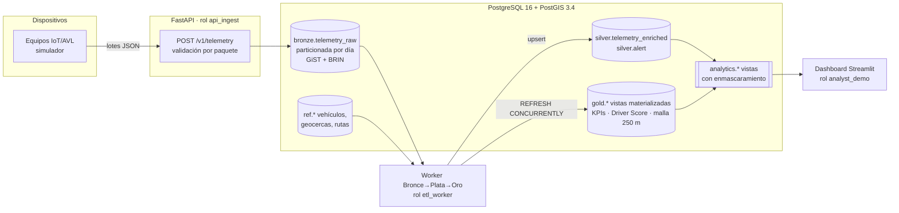

# DESIGN · Decisiones de arquitectura

Este documento explica **por qué** el pipeline está construido como está: el modelo de
capas, la estrategia de base de datos, los índices espaciales, la lógica de geocercas,
alertas y combustible, y los *trade-offs* frente a volúmenes de Big Data.
Para desplegarlo, ver [SETUP.md](SETUP.md).

---

## 1. Vista general



| Capa | Qué contiene | Quién escribe | Propiedad clave |
|---|---|---|---|
| **Bronce** | Paquetes AVL tal como llegan | API (`api_ingest`) | Inmutable, idempotente, nunca rechaza por reglas de negocio |
| **Plata** | Puntos limpios y enriquecidos + alertas | Worker (`etl_worker`) | Recalculable desde Bronce en cualquier momento |
| **Oro** | KPIs diarios, Driver Score, infracciones, malla de calor | `gold.refresh_all()` | Lecturas en milisegundos, sin bloquear al tablero |
| **analytics** | Vistas sobre Plata y Oro | — | Única superficie visible para BI; IDs enmascarados |

El principio que guía todo: **Bronce es la fuente de verdad y Plata/Oro son derivados
reproducibles**. Si cambia una regla (un límite de velocidad, el factor de seguridad de
combustible), basta con reprocesar; nunca se pierde el dato original.

---

## 2. Modelo de datos

### 2.1 Bronce: `bronze.telemetry_raw`

```
vehicle_id text, event_ts timestamptz, lat, lon double precision,
speed_kmh real, fuel_level_pct real,
geom geometry(Point,4326) GENERATED ALWAYS AS (ST_SetSRID(ST_MakePoint(lon, lat), 4326)) STORED,
source text, ingested_at timestamptz
PRIMARY KEY (vehicle_id, event_ts)        PARTITION BY RANGE (event_ts)
```

| Decisión | Motivo |
|---|---|
| **PK natural `(vehicle_id, event_ts)`** | Los equipos AVL retransmiten paquetes cuando no reciben ACK. Con `INSERT … ON CONFLICT DO NOTHING` la ingesta es **idempotente**: reenviar un lote no duplica nada. |
| **`geom` como columna generada** | Elimina el error más común en GIS: invertir `lat`/`lon` (`ST_MakePoint` recibe X = lon). El cliente envía números; la base construye la geometría siempre igual. |
| **`real` (4 bytes) para velocidad y combustible** | La precisión del sensor no justifica 8 bytes. En miles de millones de filas son GB de disco y de caché. |
| **Sin FK hacia `ref.vehicle`** | Bronce no debe perder datos porque el maestro esté desactualizado, y una FK cuesta en ingesta masiva. La validación de vehículo se hace en Plata. |
| **CHECKs solo físicos** (lat/lon en rango, velocidad 0–300, combustible 0–100) | Un salto de GPS es un dato real del equipo: se **conserva** en Bronce y se **marca** en Plata (`is_gps_outlier`). |
| **`ingested_at`** | Permite el procesamiento incremental (ver §5) y medir la latencia del equipo. |

### 2.2 Plata: `silver.telemetry_enriched` y `silver.alert`

`telemetry_enriched` tiene la misma PK y el mismo particionado que Bronce, más las
columnas calculadas: cinemática respecto al punto anterior (distancia geodésica, velocidad
implícita, aceleración), banderas (`is_gps_outlier`, `is_harsh_event`, `is_refuel`), las
geocercas del punto (`geofence_ids integer[]`), el límite aplicado y el exceso, y el estado
de combustible (consumo estimado, autonomía, km restantes de ruta, `is_low_fuel_risk`).

`silver.alert` no se particiona: su volumen es órdenes de magnitud menor (una alerta por
**episodio**, no por punto, ver §4.2). Tiene `UNIQUE (vehicle_id, event_ts, alert_type)`
para que reprocesar no duplique alertas.

### 2.3 Oro

| Objeto | Uso |
|---|---|
| `gold.vehicle_daily_kpi` | Un registro por vehículo y día local: distancia, % del tiempo en exceso, eventos bruscos/100 km, consumo, tanqueos, **Driver Score** y la traza del día (`LineString`) |
| `gold.infraction_point` | Alertas desnormalizadas con nombre y tipo de geocerca (capa de puntos del mapa) |
| `gold.infraction_grid_250m` | Malla de 250 m × 250 m con conteo de infracciones (mapa de calor) |
| `gold.driver_score()` | Fórmula del score en **un solo lugar**, `IMMUTABLE` |

Son **vistas materializadas con índice único**, lo que permite
`REFRESH MATERIALIZED VIEW CONCURRENTLY`: el tablero sigue leyendo la versión anterior
mientras se recalcula la nueva.

**Driver Score (0–100):**

```
100 − min(50, % del tiempo en exceso)
    − min(30, eventos bruscos por 100 km × 5)
    − min(20, peor exceso del día en km/h × 0.5)
```

Los tres términos están acotados para que un solo factor no hunda el puntaje a cero, y el
peso mayor va al tiempo en exceso (exposición al riesgo) frente a un pico puntual.

### 2.4 Maestros: `ref.*`

* `ref.geofence`: `MultiPolygon` en EPSG:4326, `zone_type` (enum), límite opcional
  (`NULL` = geocerca solo de monitoreo), `CHECK (ST_IsValid(geom))`. Una geometría
  inválida (polígono que se auto-intersecta) daría resultados de `ST_Intersects`
  impredecibles; se rechaza al cargarla.
* `ref.route` + `ref.vehicle_route_assignment`: ruta planificada por vehículo, con
  vigencia (`valid_from`/`valid_to`) e índice único parcial que garantiza **una sola ruta
  activa** por vehículo. Es la base de la "autonomía de ruta" del modelo de combustible.

### 2.5 Parámetros de negocio: `ops.parameter`

Tolerancia de velocidad, umbrales de aceleración, factor de seguridad de combustible,
ventana de consumo, etc. viven en una tabla, no en el código. `PipelineParameters`
(Python) es su espejo tipado y un test de integración verifica que ambos coinciden.

---

## 3. Sistemas de referencia (CRS)

| CRS | Dónde | Por qué |
|---|---|---|
| **EPSG:4326** (WGS84) | Almacenamiento de todas las geometrías | Es lo que emite el GPS; sin transformaciones en la ingesta; estándar para mapas web. |
| **`geography` / haversine** | Distancias entre puntos consecutivos | Distancia geodésica correcta en metros, sin depender de una proyección. |
| **EPSG:9377** (MAGNA-SIRGAS / Origen-Nacional) | Malla de calor de 250 m y cálculos de ruta en Python | Sistema métrico **oficial de Colombia** (IGAC, 2020): una celda de 250 m mide 250 m reales en todo el país. En grados, una "celda" cambiaría de tamaño con la latitud. |

`00_extensions.sql` registra EPSG:9377 en `spatial_ref_sys` solo si la versión de
PostGIS no lo trae.

---

## 4. Analítica espacial (capa Plata)

### 4.1 Geocercas

**En la base (modo batch):** el worker obtiene las geocercas de cada punto con un
`LEFT JOIN LATERAL` (`processing/queries.py`):

```sql
FROM bronze.telemetry_raw b
LEFT JOIN LATERAL (
    SELECT array_agg(g.geofence_id ORDER BY g.geofence_id) AS geofence_ids
    FROM ref.geofence g
    WHERE g.active AND ST_Intersects(g.geom, b.geom)
) gf ON true
```

Cómo se ejecuta:

1. `ST_Intersects` incluye implícitamente el operador `&&` (intersección de *bounding
   boxes*), que **usa el índice GiST** `geofence_geom_gist`. Descarta en O(log n) todas las
   geocercas cuyo rectángulo no contiene el punto.
2. Solo con los candidatos se ejecuta el test exacto punto-en-polígono.
3. El índice es **parcial** (`WHERE active`): las geocercas desactivadas no ocupan índice
   ni se evalúan.

**`ST_Intersects` y no `ST_Contains`/`ST_Within`.** Con `ST_Contains`, un punto
exactamente sobre el borde queda **fuera**. Un vehículo que circula por la calle que
limita una zona escolar no se evaluaría con el límite escolar. `ST_Intersects` cuenta el
borde como dentro, que es la interpretación conservadora para seguridad vial.

**En memoria (modo tiempo real):** `GeofenceIndex` usa un `STRtree` de Shapely (R-tree,
el equivalente del GiST) con el mismo predicado. Un test de integración
(`test_postgis_geofences_match_python_index`) verifica que **PostGIS y Python asignan
exactamente las mismas geocercas** a cada punto del escenario, incluidos los solapes.

### 4.2 Límite de velocidad dinámico y alertas

Un punto puede estar en varias geocercas a la vez (una zona escolar dentro del perímetro
urbano, un tramo de alta siniestralidad sobre una autopista). La regla **no** es "el
límite mínimo", sino **la zona más específica**:

```
SCHOOL > RESTRICTED > HIGH_RISK > DEPOT > HIGHWAY > URBAN
```

A igual prioridad gana el límite más bajo; sin geocerca con límite se aplica
`default_speed_limit_kmh`. Así, un corredor rápido dentro del perímetro urbano puede
tener un límite **mayor** que el urbano, algo que la regla del mínimo no permite.

Escenario Bogotá: las tres rutas siguen la **red vial real**. Se calcularon una vez con
OSRM sobre OpenStreetMap (`scripts/fetch_osm_routes.py`) y se versionan como GeoJSON, de
modo que el proyecto no depende de internet. Los corredores de la Autopista Norte y la
Autopista Sur son los tramos de esas rutas que recorren cada autopista. Límites: 50 km/h general (incluye autopistas, según la norma distrital), 30 km/h
en zona escolar, y 20 km/h en el patio como **política interna** de la empresa.

**Severidad** (`rules/speed.py`): se declara exceso solo por encima de
`límite + tolerancia` (3 km/h, error típico del GPS). El exceso se mide contra el límite
real: < 10 km/h LOW, < 20 MEDIUM, < 30 HIGH, ≥ 30 CRITICAL. En zonas **SCHOOL** y
**HIGH_RISK** la severidad **sube un nivel**: 15 km/h de exceso frente a un colegio no
pesa lo mismo que en una avenida.

**Una alerta por episodio.** Tres minutos a 70 km/h en zona de 50 son ~60 reportes en
exceso. Emitir 60 alertas inunda al operador y distorsiona los conteos. El
`TrackProcessor` emite una alerta al **iniciar** el episodio y otra solo si la severidad
**escala** dentro del mismo; el episodio termina cuando la velocidad vuelve al límite.
Los puntos individuales en exceso siguen marcados en Plata (`is_speeding`) para medir
el tiempo en exceso.

**Robustez del GPS** (`rules/track.py`): si la velocidad implícita entre dos posiciones
supera 200 km/h, el punto es un *outlier* de GPS. Se marca y no se usa como referencia
ni para el odómetro, y mantiene las geocercas de la última posición válida. Si llegan 3
*outliers* seguidos, lo más probable es que el erróneo fuera el punto de referencia y la
traza se re-ancla.

### 4.3 Consumo predictivo de combustible

Pregunta de negocio: **¿le alcanza el combustible para terminar la ruta asignada?**
(`rules/fuel.py`, `spatial/routes.py`)

1. **Consumo real (L/100 km):** regresión lineal por mínimos cuadrados del nivel de
   combustible (%) contra el odómetro (km) en una **ventana móvil de 30 km**. La
   pendiente de la regresión es robusta al ruido del sensor de nivel (±0,1–0,3 %), cosa
   que no ocurre al restar el primer y el último valor. Validación con el escenario: el
   consumo estimado fue 31,9 L/100 km frente a 32 reales.
2. **Respaldo:** con menos de 3 km de recorrido en la ventana, o una estimación fuera de
   0,25×–4× del nominal (p. ej. un tramo corto en bajada), se usa el consumo de ficha
   técnica del vehículo.
3. **Tanqueos:** una subida ≥ 5 % del nivel es un tanqueo. La ventana se **reinicia**,
   porque mezclar antes y después de tanquear daría una pendiente sin sentido.
4. **Autonomía** = litros actuales / consumo × 100.
5. **Distancia restante:** el punto se proyecta sobre la ruta en EPSG:9377. Lo que falta
   es el tramo de ruta desde la proyección hasta el final **más** la distancia
   perpendicular (si el vehículo se desvió, primero debe volver).
6. **Riesgo:** `CRITICAL` si la autonomía no cubre lo que falta; `HIGH` si la cubre pero
   sin el margen de seguridad (`fuel_safety_factor` = 1,15). Misma política de una alerta
   por episodio.

Limitación conocida: en rutas que se cruzan o regresan sobre sí mismas la proyección al
punto más cercano es ambigua. Se resolvería restringiendo la búsqueda a partir del
último progreso conocido.

---

## 5. Procesamiento incremental (worker)

`processing/worker.py` (`python -m simon_geo.processing [--loop]`):

```
BEGIN
  SELECT … FROM ops.watermark … FOR UPDATE           -- serializa workers
  vehículos con ingested_at > watermark               -- índice BRIN sobre ingested_at
  por vehículo:
     leer Bronce desde (primer event_ts nuevo − lookback) + geocercas (LATERAL/GiST)
     enriquecer en orden (TrackProcessor)
     escribir solo desde el primer event_ts nuevo:
        upsert silver.telemetry_enriched
        DELETE + INSERT silver.alert del rango
  UPDATE ops.watermark
COMMIT
gold.refresh_all()                                    -- transacción aparte
```

| Decisión | Motivo |
|---|---|
| **Watermark por `ingested_at`, no por `event_ts`** | Un equipo sin señal acumula horas de datos y los envía después. Por `event_ts` esos paquetes quedarían detrás del watermark y no se procesarían nunca. |
| **Margen `settle`** | `ingested_at = now()` es la hora de **inicio** de la transacción de ingesta. Una transacción aún abierta podría confirmar después con un `ingested_at` menor que el watermark. Solo se procesa hasta `clock_timestamp() − settle`. |
| **Lookback de 2 h** | El enriquecimiento tiene **estado** (episodio de exceso en curso, odómetro, ventana de consumo). Si cada lote empezara de cero, un exceso que cruza dos lotes generaría una alerta duplicada al inicio del segundo. Los puntos del lookback solo "calientan" el estado y no se reescriben. Un test unitario demuestra que con lookback el resultado es idéntico a procesar todo de una vez, y sin él no. |
| **Datos tardíos** | Si llega un punto con `event_ts` antiguo, se reprocesa la traza **desde ese punto hasta el final** (upsert de los puntos y borrado/reinserción de las alertas del rango). Así las alertas posteriores quedan coherentes con el nuevo dato. |
| **Todo en una transacción** | Si algo falla, rollback: el watermark no avanza y el lote se reintenta completo. Todas las escrituras son idempotentes. |
| **Oro en transacción aparte** | Un fallo al refrescar Oro no debe deshacer un lote de Plata ya válido; el siguiente refresco lo recupera. |

El enriquecimiento (`SilverEnricher`, `enrich_window`) **no hace E/S**: el mismo código
corre en los tests unitarios, en el simulador y en el worker. El test de integración del
worker comprueba que las alertas escritas en la base son **idénticas** a las del pipeline
en memoria.

---

## 6. Estrategia de índices

| Tabla | Índice | Tipo | Para qué consulta |
|---|---|---|---|
| `ref.geofence` | `geom WHERE active` | **GiST parcial** | Punto-en-polígono del enriquecimiento |
| `bronze.telemetry_raw` | `geom` | **GiST** | "Puntos dentro de este polígono/bbox" ad hoc |
| `bronze.telemetry_raw` | `event_ts`, `ingested_at` | **BRIN** | Rangos de tiempo; worker incremental |
| `bronze.telemetry_raw` | PK `(vehicle_id, event_ts)` | B-tree | Traza de un vehículo; idempotencia |
| `silver.telemetry_enriched` | `geom` | **GiST** | Filtros por mapa |
| `silver.telemetry_enriched` | `geofence_ids` | **GIN** | "Puntos en la geocerca X" **sin geometría** (`geofence_ids @> '{5}'`) |
| `silver.telemetry_enriched` | `event_ts WHERE is_speeding` | B-tree **parcial** | Excesos en un periodo (fracción pequeña del total) |
| `silver.alert` | `geom` / `event_ts` / `(alert_type, event_ts)` | GiST / B-tree | Mapa de alertas y listados |
| `gold.*` | Únicos + GiST sobre `track_geom`, `geom`, `cell_geom` | B-tree / GiST | `REFRESH CONCURRENTLY` y filtros del tablero |

**¿Por qué BRIN para el tiempo?** La telemetría llega casi ordenada en el tiempo, así que
cada bloque de disco contiene un rango estrecho de `event_ts`. BRIN guarda solo el
mín/máx por grupo de 32 páginas: ocupa **KB** frente a los **cientos de MB** de un B-tree
equivalente sobre cientos de millones de filas, y casi no cuesta en la ingesta. Combinado
con el particionado diario, una consulta de "ayer" lee una sola partición y, dentro de
ella, solo los bloques del rango.

**¿Por qué GiST y no SP-GiST o H3 para los puntos?** GiST es el índice estándar de
PostGIS, soporta todos los operadores espaciales (`&&`, `ST_Intersects`, `ST_DWithin`,
KNN `<->`) y funciona igual para puntos y polígonos. Una malla H3 sería una buena
adición para agregaciones (ver §8), no un reemplazo.

**GIN sobre `geofence_ids`.** El cálculo espacial caro (punto-en-polígono) se hace **una
sola vez** en Plata y se guarda como arreglo. Las consultas de BI ("cuánto tiempo pasó la
flota en zonas escolares") se responden con el índice GIN sin volver a tocar geometrías.

### Resultados medidos

Con **5.040.000 puntos** (500 vehículos × 7 días, un reporte por minuto) en una tabla con la
misma definición e índices que Bronce. Se usó PostgreSQL 19 + PostGIS 3.7 con la
configuración **por defecto** (`shared_buffers` 128 MB, `work_mem` 4 MB); el detalle y los
planes completos están en [docs/benchmark.md](docs/benchmark.md).

| Consulta | Con la estrategia de índices | Sin ella | Qué demuestra |
|---|---:|---:|---|
| Puntos dentro de la zona escolar en un día | **0,4 ms** (274 páginas) | 103 ms sin GiST (11.079 páginas, *Seq Scan*) | GiST: ~250× más rápido y 40× menos E/S |
| La misma consulta sin filtro de tiempo | 0,4 ms (1 partición) | 59 ms (7 particiones) | Poda de particiones: solo se toca el día pedido |
| Viewport del mapa en una hora | **5 ms** | 9 ms sin BRIN (4.555 páginas) | PostgreSQL **combina** BRIN (tiempo) y GiST (espacio) en un *BitmapAnd* |
| Traza de un vehículo en un día | **1,3 ms** | — | La PK `(vehicle_id, event_ts)` sirve también como índice de consulta |
| Geocercas de una hora (consulta del worker, ~30.000 puntos) | **54 ms** | — | ~560.000 puntos/s de punto-en-polígono, usando `geofence_geom_gist` |
| Malla de calor de excesos, un día | **262 ms** | 1,4 s para 7 días | Agregación sin índice útil; la poda acota el trabajo a un día |

| Índice | Tamaño (5 M filas) |
|---|---:|
| BRIN sobre `event_ts` | **224 KB** |
| B-tree equivalente sobre `event_ts` | 35,3 MB (**~160×** más grande) |
| GiST sobre `geom` | 202 MB |
| Tabla | 606 MB |

Lectura honesta de los números:

* El índice que más cambia el resultado es el **GiST** en consultas por polígono; el BRIN
  y la poda reducen el volumen a un día o a una hora antes de que el GiST trabaje.
* En el viewport de una hora el GiST aporta poco (5 → 8 ms), porque el BRIN ya dejó solo
  ~30.000 candidatos. Los índices se complementan; ninguno basta solo para todo.
* La carga fue de **~44.000 filas/s** con todos los índices activos y en una sola sesión.
  El costo dominante es mantener el GiST y la PK. Para más volumen, el camino es cargar
  con `COPY` y en varias sesiones en paralelo (por ejemplo, una por partición); no se midió
  en esta prueba.
* La malla de calor de Oro no se calcula al consultar: es una vista materializada, de modo
  que el tablero lee el resultado ya agregado.

---

## 7. Seguridad y privacidad

**El enmascaramiento ocurre en PostgreSQL, no en la API.** Si se hiciera en la API,
cualquier herramienta de BI conectada directamente a la base (Power BI, Metabase, un
`psql`) vería las placas. En la base, la regla se cumple **para todos los clientes**.

* **Roles de mínimo privilegio** (`06_security.sql`): `telemetry_ingest` solo inserta en
  Bronce; `pipeline_worker` lee Bronce y escribe Plata; `bi_analyst` **solo** ve el
  esquema `analytics`; `fleet_admin` ve todo.
* **Vistas `analytics.*`:** el mismo `SELECT` devuelve `VHC-****-ABC` a un analista y
  `VHC-8472-ABC` a un administrador (`security.is_admin()`, evaluado una vez por consulta
  y no por fila).
* **`security_barrier`:** sin esta opción, el optimizador podría evaluar un predicado del
  usuario (`WHERE vehicle_id LIKE 'VHC-84%'`) **antes** del enmascaramiento y revelar
  la placa por inferencia.
* **Seudónimo estable `vehicle_key`** (`VK-…`, SHA-256 con sal secreta): el analista
  puede agrupar y seguir a un vehículo en el tiempo sin conocer su placa. Se calcula una
  vez por vehículo (trigger) y la función que lo genera no es ejecutable por analistas
  (evita ataques de diccionario sobre el espacio de placas).
* **Funciones `SECURITY DEFINER`** con `search_path` fijado, para que un rol no pueda
  suplantar funciones por nombre.
* **API:** la API key solo determina **con qué usuario de base** se conecta la petición.
  La lógica de enmascaramiento no está duplicada en Python.

---

## 8. Trade-offs y escalamiento a Big Data

### Decisiones tomadas para el volumen

| Técnica | Beneficio | Costo asumido |
|---|---|---|
| **Particionado diario** | *Partition pruning*; `VACUUM`/índices por partición; retención = `DROP TABLE` instantáneo (sin `DELETE` masivo ni *bloat*) | Más objetos en el catálogo; la PK debe incluir `event_ts`; hay que crear particiones con antelación (`ops.ensure_daily_partitions`, que también llaman la API y el worker) |
| **Partición DEFAULT** | Un reloj de equipo desfasado no hace fallar la ingesta | Debe vigilarse: si acumula filas de un día, crear después esa partición falla hasta moverlas |
| **Ingesta por lotes** (`INSERT … SELECT FROM unnest(arrays)`) | Un viaje de red y un plan por lote, en vez de N `INSERT` | Un lote con un error de base falla entero (los errores de validación se filtran antes, por paquete) |
| **Geocercas precalculadas en Plata** | El punto-en-polígono se hace una vez por punto, no en cada consulta de BI | Si cambia una geocerca hay que reprocesar el rango afectado |
| **Vistas materializadas en Oro** | El tablero lee agregados pequeños en ms | Frescura = frecuencia del worker; el refresco completo crece con la historia (ver abajo) |
| **Tipos compactos** (`real`, `smallint`) | Menos disco y más filas por página de caché | Precisión menor, irrelevante frente al error del sensor |
| **Ajustes de PostgreSQL** (`docker-compose.yml`) | `random_page_cost=1.1` (SSD), `effective_io_concurrency=200`, `shm_size` para consultas paralelas, `jit=off` (las consultas cortas pierden más compilando que ejecutando) | Valores pensados para una máquina de desarrollo |

### Cómo escalaría más allá de esta prueba

1. **Ingesta:** la API escribe directo en PostgreSQL. Con decenas de miles de mensajes
   por segundo se pondría **Kafka / Redpanda** (o MQTT → Kafka) delante. La API solo
   publica, y un consumidor carga en Bronce con `COPY` en micro-lotes. Kafka además
   absorbe caídas de la base sin perder datos.
2. **Oro incremental:** las vistas materializadas se recalculan completas. Con años de
   historia pasarían a tablas que se actualizan por **día afectado** (el worker ya sabe
   qué vehículos y días tocó), o a **continuous aggregates de TimescaleDB**.
3. **Almacenamiento:** **TimescaleDB** (hypertables con compresión columnar, 10–20× en
   telemetría) o **Citus** para distribuir por `vehicle_id` entre nodos. El esquema ya
   está preparado: la clave natural `(vehicle_id, event_ts)` es la clave de distribución
   natural.
4. **Histórico frío:** las particiones de más de N meses se exportan a **Parquet
   (GeoParquet)** en almacenamiento de objetos y se consultan con DuckDB/Trino. En
   PostgreSQL queda solo la ventana caliente.
5. **Worker:** hoy procesa vehículo por vehículo en un proceso. Escala horizontalmente
   particionando vehículos por *hash* entre workers (un watermark por partición de
   vehículos), igual que las particiones de un *topic* de Kafka.
6. **Agregaciones espaciales:** una columna **H3** (resolución 9, ~0,1 km²) calculada en
   Plata permitiría mapas de calor jerárquicos y joins por celda sin geometrías.

### Limitaciones conocidas

* Con datos tardíos, el lookback del worker es de 2 h fijas. Un hueco mayor reinicia el
  estado de la traza, lo que afecta a la ventana de consumo y al episodio en curso.
* La ventana de consumo de 30 km no distingue carga del vehículo ni pendiente del
  terreno. Un modelo por tipo de vehículo y tramo de ruta mejoraría la estimación.
* El límite por defecto (80 km/h) aplica fuera de toda geocerca. En una operación real
  se tomaría de una capa de límites viales (OpenStreetMap `maxspeed`) asociada por
  *map-matching*.
