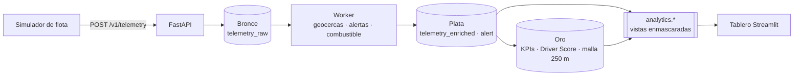

# Seguimiento GPS flota vehicular

[](https://github.com/JuanManceraS9402/PruebaTec/actions/workflows/ci.yml)

**[▶ Ver el video de la solución (4:34)](https://drive.google.com/file/d/19eWr2tHXEOfCehGEjGtlpuai3H7tUtob/view?usp=drive_link)**

Pipeline **Bronce → Plata → Oro** sobre PostgreSQL + PostGIS. Ingiere telemetría IoT/AVL,
la enriquece con geocercas, genera alertas y expone KPIs de *Driver Score* para BI:

* **Ingesta** idempotente por API (FastAPI), con **enmascaramiento de IDs** (`VHC-****-ABC`)
  aplicado en la base de datos según el rol de quien consulta.
* **Geocercas reales de Bogotá** (2.257: perímetro urbano del POT, zonas escolares y
  tramos críticos de siniestralidad de la Secretaría de Movilidad) con `ST_Intersects`
  sobre índices **GiST**, verificadas contra un índice R-tree en Python que da
  exactamente el mismo resultado.
* **Alertas de velocidad** cuyo límite depende de la geocerca (zona escolar, alta
  siniestralidad, corredor, patio), con severidad escalada y **una alerta por episodio**.
* **Combustible predictivo**: consumo real por regresión en ventana móvil, autonomía y
  alerta si no alcanza para terminar la **ruta asignada**.
* **Capa Oro** con vistas materializadas (KPIs diarios, Driver Score, malla de 250 m y
  zonas calientes por DBSCAN en EPSG:9377) y un **tablero Streamlit** con mapa.
* **Simulador en el tablero:** marcas inicio y fin en un mapa, eliges conductor y
  combustible, y el vehículo recorre el pipeline real (API → Bronce → worker → Oro).
* **Benchmark** con millones de puntos que compara planes con y sin GiST/BRIN y con y
  sin poda de particiones.

| Documento | Contenido |
|---|---|
| [DESIGN.md](DESIGN.md) | Arquitectura, modelo de datos, índices, lógica espacial, seguridad y trade-offs para Big Data |
| [SETUP.md](SETUP.md) | Despliegue local paso a paso (Docker + Python) |
| [docs/benchmark.md](docs/benchmark.md) | Resultados de `EXPLAIN (ANALYZE, BUFFERS)` sobre millones de puntos |
| [docs/benchmark_gold.md](docs/benchmark_gold.md) | Capa Oro con 5 M de puntos: todas las consultas del tablero por debajo de 100 ms |

## Inicio rápido

```bash
cp .env.example .env
docker compose up -d --wait                      # PostGIS con todo el esquema
python -m venv .venv && .venv/Scripts/activate   # Linux/macOS: source .venv/bin/activate
pip install -e ".[dev,dashboard]"

python -m gps_flota.seed                         # vehículos, geocercas y rutas de Bogotá
uvicorn gps_flota.api.app:app                    # API en :8000 (otra terminal)
python -m gps_flota.simulator --out data/telemetry.jsonl --api-url http://localhost:8000
python -m gps_flota.processing                   # Bronce → Plata → Oro
streamlit run dashboard/app.py                   # tablero en :8501
```

## Flujo de datos



## Estructura

```
.
├── docker-compose.yml          # PostGIS 16 + 3.4, inicialización automática
├── db/init/                    # Esquema completo, se ejecuta al crear la base
│   ├── 00_extensions.sql       #   PostGIS, pg_stat_statements, EPSG:9377
│   ├── 01_schemas_ops.sql      #   Esquemas por capa, parámetros, watermark, particionado
│   ├── 02_reference.sql        #   Vehículos, geocercas, rutas (GiST)
│   ├── 03_bronze.sql           #   Telemetría cruda: particiones diarias, GiST + BRIN
│   ├── 04_silver.sql           #   Telemetría enriquecida y alertas
│   ├── 05_gold.sql             #   Vistas materializadas y Driver Score
│   ├── 06_security.sql         #   Roles, enmascaramiento, esquema analytics
│   ├── 07_users.sh             #   Usuarios de login
│   └── 08_sandbox.sql          #   Funciones del simulador (solo administrador)
├── src/gps_flota/
│   ├── api/                    # FastAPI: ingesta por lotes y lectura de alertas por rol
│   ├── spatial/                # CRS (EPSG:9377), haversine, geocercas (STRtree), rutas
│   ├── rules/                  # Velocidad, cinemática, combustible, TrackProcessor
│   ├── processing/             # Enriquecimiento, consultas SQL-espaciales, worker
│   ├── simulator/              # Flota simulada (perfiles, ruido, duplicados, outliers)
│   ├── seed/                   # Escenario Bogotá
│   ├── benchmark/              # Generador masivo y lectura de planes EXPLAIN
│   ├── sandbox.py              # Simulación bajo demanda de un vehículo
│   ├── routing.py              # Ruta por vías entre dos puntos (OSRM)
│   └── dashboard/              # Datos, capas, gráficos, secciones y simulador del tablero
├── dashboard/app.py            # Punto de entrada del tablero Streamlit
├── scripts/                    # Descarga de rutas (OSRM) y geocercas (datos abiertos)
├── tests/
│   ├── unit/                   # Sin base de datos
│   └── integration/            # Contra PostGIS (docker compose)
└── .github/workflows/ci.yml    # Lint + unitarias + integración con PostGIS real
```

## Pruebas

```bash
pytest -m "not integration"   # unitarias, sin base de datos
pytest -m integration         # requieren docker compose up + seed
```

La CI ejecuta ambas: la de integración levanta el mismo `docker compose` que SETUP.md, de
modo que cada *push* valida el SQL completo contra PostGIS real.

Las pruebas cubren lo crítico del dominio:

* Geocercas: bordes, solapes, prioridad de zonas, y **PostGIS = Python** punto a punto.
* Velocidad: tolerancia, severidad, escalamiento por zona, una alerta por episodio.
* Combustible: regresión con ruido, tanqueos, autonomía y riesgo de ruta.
* GPS: outliers y re-anclaje de la traza.
* Worker: lookback, datos tardíos, idempotencia y alertas en la base **idénticas** al
  pipeline en memoria.
* Seguridad: permisos por rol y enmascaramiento.

## Modelo de acceso

| Usuario | Rol | Puede |
|---|---|---|
| `api_ingest` | `telemetry_ingest` | Insertar en `bronze.telemetry_raw` |
| `etl_worker` | `pipeline_worker` | Leer Bronce, escribir Plata, refrescar Oro |
| `analyst_demo` | `bi_analyst` | Leer solo `analytics.*`, con IDs enmascarados (`VHC-****-ABC`) |
| `admin_demo` | `fleet_admin` | Leer todas las capas, con IDs reales |

---

### Datos y créditos

| Dato | Fuente | Licencia |
|---|---|---|
| Rutas, corredores y mapa del selector de puntos | © colaboradores de [OpenStreetMap](https://www.openstreetmap.org/copyright), calculadas con [OSRM](https://project-osrm.org/) | ODbL |
| Perímetro urbano (POT) | [Secretaría Distrital de Planeación](https://datosabiertos.bogota.gov.co/dataset/perimetro-urbano-bogota-d-c) | CC BY 4.0 |
| Zonas escolares | [Colegios Bogotá D.C.](https://datosabiertos.bogota.gov.co/dataset/colegios-bogota-d-c), Secretaría de Educación del Distrito | CC BY-SA 4.0 |
| Tramos y puntos críticos de siniestralidad 2022–2025 | [Oficina de Seguridad Vial, Secretaría Distrital de Movilidad](https://sig.simur.gov.co/arcgis/rest/services/DatosAbiertos) | CC BY 4.0 |
| Ortofoto urbana 2025 | [Secretaría Distrital de Planeación, publicada por IDECA – UAECD](https://serviciosgis.catastrobogota.gov.co/image/rest/services/imagenesfunciones/orthourbana2025funcion/ImageServer) | Servicio público de IDECA |
| Mapa base | © [CARTO](https://carto.com/attributions) | — |

El patio logístico y la flota son ficticios. Las zonas escolares derivadas (100 m por sede)
se distribuyen bajo CC BY-SA 4.0, como la fuente.
